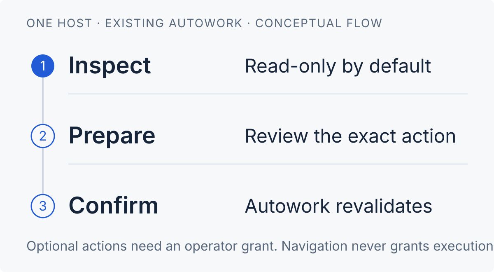

# Autowork for Paseo

**See the work. Review the plan. Confirm the action.**

Inspect an existing Linux [Autowork](https://github.com/TrebuchetDynamics/autowork) installation from Paseo. See runners, task contracts, blockers and logs in one native interface. Enable planning and runner controls only when you need them.

This is a **plugin**, not a provider, scheduler or bundled Autowork engine. It targets Android, desktop and web through React Native.

> **Read-only by default.** No model calls or mutation grants without operator configuration.
>
> **Qualification:** offline checks include the real Paseo compiler and an isolated server load. Physical Android and Linux Desktop UI checks, real planning and service-control qualification remain **pending**. No existing daemon was installed, enabled or reloaded during development. See the [qualification record](docs/qualification.md).

[Install](#install-only-after-reviewing-trusted-code) · [Host policy](#opt-in-host-policy) · [Planning](#planning-and-decisions) · [Security](docs/security.md) · [Qualification](docs/qualification.md)

<p>
  
</p>

The diagram describes the control flow. It is not a screenshot. Inspection is read-only. Optional actions require an operator grant, an exact-action review and explicit confirmation. Autowork revalidates authority before execution.

## What you can do

- **Inspect runners:** read canonical status, lanes and bounded logs. Service liveness alone does not prove productive work.
- **Review tasks:** filter by task, goal, runtime or section. Browse 25 summaries per page. Inspect committed contracts and distinguish manual closure from verified closure.
- **Resolve blockers:** inspect current owner questions separately from technical holds. With permission, prepare a revision-bound owner answer.
- **Plan with review:** start an owned planning session, inspect the proposal and explicitly apply an exact preview. Planning does not start a runner.

## Requirements

- Paseo **0.13.x**, for both the daemon and connected app. The manifest rejects unqualified later minor versions.
- A Linux daemon host with Node 24+, Git, Python 3.11+ and an existing `autowork` on its trusted PATH.
- Autowork with `prepare_api: 4`, JSON fleet/task commands and current planning controller interfaces. The development read-only smoke check used release `01e37ea049c3153948ebfbbdb54aff38fe749266`.
- For opt-in planning: an existing configured Pi installation/provider and ignored canonical `.worktrees/`. The plugin does not install a model/runtime or edit credentials.

## Install, only after reviewing trusted code

Source is in the private [TrebuchetDynamics/paseo-autowork](https://github.com/TrebuchetDynamics/paseo-autowork) repository. You need an authorized checkout. No public source or registry release is available.

**Select the daemon host first.** Run the commands on that machine. If plugins are globally disabled, enable them only after consenting to Paseo's trust warning.

> **Trusted, unsandboxed code:** installing a Paseo plugin grants code execution as the daemon user. Review [security](docs/security.md) before installation. Install only into the intended host.

From the local checkout:

```sh
npm ci --ignore-scripts
npm run check
paseo plugin install /absolute/path/to/paseo-autowork
paseo plugin ls
```

For a first read-only check:

1. Confirm that `paseo plugin ls` reports `paseo-autowork` as `running`.
2. Select **Autowork** in Paseo's sidebar on that host.
3. Select **Refresh**. Inspect the repositories already known to Autowork.

Paseo owns host selection. Inventories and caches never merge across hosts. An offline or unknown host does not fall back to another machine. Workspace and agent panels show only known repositories that match the workspace directory.

These commands are installation instructions, not actions performed by this repository.

## Read-only by default

Without configuration, the plugin discovers repositories through `autowork ls --json`. It reuses Autowork's health and owner-question interpretation. It reads committed task inventory, committed contract details, logs and evidence labels.

Missing transport, runtime-version or delivery evidence is **unknown**. The plugin does not infer it from configuration or historical in-flight records. Canonical stalled, paused and waiting states remain distinct. Uncommitted task edits are not accepted committed scope. Closure labels distinguish manual closure, verified closure, missing/invalid receipts and absent provenance.

<details>
<summary><strong>Refresh, task browsing and composer commands</strong></summary>

- Fleet and active task views refresh at most every 20 seconds while foregrounded and online. Errors use bounded backoff. Pull to refresh or select **Refresh** for a fresh read.
- The server shares a five-second collector cache and one in-flight fleet read per plugin installation. Capture time and source revision remain visible.
- `/aw-status`, `/aw-tasks`, `/aw-plan` and `/aw-blockers` open the native workspace. Optional `/aw-plan` text is a draft objective, not permission to run a model.
- Task and blocker lists show result counts and at most 25 task summaries per page. Filters apply to the full snapshot before pagination. **Clear task filters** resets the search. Empty queues, unmatched filters and read failures remain distinct. Pagination bounds rendering, not upstream snapshot size.

</details>

## Opt-in host policy

There is **no client toggle that grants execution**. An operator can supply a private JSON policy file and set `PASEO_AUTOWORK_CONFIG` in the **daemon's environment**. Omit grants you do not need.

> Paseo 0.13 requires `daemon.manage` for plugin RPC, but its public handler has no end-user principal. These grants are **shared by authenticated daemon managers**, not a per-user ACL. Do not use this policy model with mutually untrusted managers.

<details>
<summary><strong>Policy example and deployment limits</strong></summary>

```json
{
  "executable": "/usr/local/bin/autowork",
  "repositories": ["/srv/projects/example"],
  "planning": true,
  "decisions": true,
  "controls": ["pause", "resume", "stop", "restart", "start"]
}
```

Use an absolute, daemon-user-owned regular file, not a symlink. Set its mode to `0600`. `repositories` adds exact canonical Git roots to the known fleet. It does not start services. Executable resolution is server-side and must be absolute when configured. Unknown repository paths cannot be submitted through RPC.

A running daemon does not inherit a later shell export. Apply environment/startup changes through your existing, separately authorized Paseo deployment procedure. Then explicitly reload this plugin. The plugin never changes daemon configuration, enables itself, installs services automatically on load or refreshes credentials. Inspect granted operations before use.

</details>

## Planning and decisions

Proposals remain unaccepted until you review and apply them.

1. Choose **Planning** and optionally enter an objective. An empty objective uses the existing autonomous `/plan_for_me` discovery.
2. Prepare and confirm the planning start. Autowork's Planner and PlanningHub own the turn, task staging and private histories.
3. Inspect progress, history, roadmap and preview. Follow-up, steering and cancellation apply only to sessions created by this plugin generation.
4. Select **Prepare Apply exact preview**, then explicitly confirm. Autowork revalidates the exact revision and repository authority.
5. Apply creates a local commit through Autowork. It does not grant push or start a service. Existing authorized runners may pick up newly accepted tasks.

Only current canonical owner questions for open tasks expose **Answer**. Answers use `autowork tasks decide --expect <displayed record hash>` and leave an **uncommitted local task edit**. Free text never changes typed live/publication grants or manufactures completion. Technical holds and accepted deferrals remain inspection work, not invented owner questions.

<details>
<summary><strong>Planning ownership and retained state</strong></summary>

The plugin never takes over Autowork workers or Paseo-created agent sessions.

Planning state lives under the daemon user's `XDG_STATE_HOME/paseo-autowork/planning/<generation>/`, or `~/.local/state/...`. It contains upstream-owned planning records, not a new event database.

Disable/reload cancels owned turns with bounded cleanup. Retained worktrees and history are not deleted. After reload, the plugin refuses to adopt old sessions whose active ownership it cannot prove. Use existing Autowork tools to reconcile them.

</details>

## Runner controls

Allowed controls use fixed Autowork arguments, never arbitrary shell: **start, pause, resume, stop and default restart**.

> **Start may install/start a user service and incur model use.** The confirmation states this. No force, stop-workers, process-group killing, model changes, task closure or Git operations are exposed.

Each action requires a short-lived, single-use confirmation bound to the plugin generation, exact repository identity/revision, service state, payload and effective publication policy. Changed targets, expired confirmations and stale generations are refused. Duplicate submissions return the retained operation, not another dispatch.

A command exit and observed service state are distinct. Unknown delivery and timeouts are **never automatically retried**.

## Development and packaging

```sh
npm ci --ignore-scripts
npm run typecheck              # native client without DOM/Node globals; separate Node server/test config
npm test                      # disposable repositories, fake CLI/controller and isolated real Paseo runtime
npm run package:check
npm pack --ignore-scripts     # creates an installable source archive; does not publish
```

Paseo supplies its runtime modules. Pinned host modules are development dependencies only. The source archive includes client/server/shared entries and README assets. It excludes the Autowork engine, node_modules, credentials and private runtime state. No build step or postinstall daemon activation is required.

<details>
<summary><strong>Upgrade and remove</strong></summary>

For upgrades, review code and compatibility, then run checks. Explicitly run `paseo plugin reload paseo-autowork` on the chosen daemon. Reload is a trusted-code operation.

Remove with `paseo plugin remove paseo-autowork`. Source repositories, Autowork services, tasks and retained planning work remain. No automatic restore, cleanup or worker interruption is performed.

</details>

### Further reading

[Architecture](docs/design.md) · [Security](docs/security.md) · [Qualification](docs/qualification.md) · [Ranked follow-ups](docs/follow-ups.md) · [Patterns learned from similar plugins](docs/plugin-patterns.md)

## Official references

- [Paseo plugins](https://paseo.sh/docs/plugins)
- [Paseo plugin reference](https://paseo.sh/docs/plugins/reference)
- [Pinned Paseo SDK source](https://github.com/getpaseo/paseo/tree/72e3316f4f5dfe775c77dbf998968c92e2de9019/packages/plugin)
- [Autowork](https://github.com/TrebuchetDynamics/autowork)

[MIT license](LICENSE)
