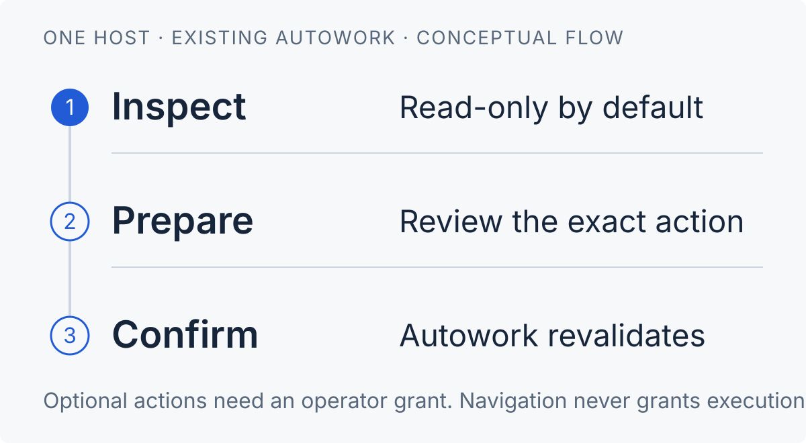

# Autowork for Paseo

**See the work. Review the plan. Confirm the action.**

Manage an existing Linux [Autowork](https://github.com/TrebuchetDynamics/kit) installation from Paseo. See runners, task contracts, goals, blockers, logs and the scorecard in one native interface. With an operator policy, run every `autowork` command from the same screens: task edits and commits, runner controls and maintenance, owner answers and staged planning. Every mutation shows the exact action and waits for your confirmation.

This is a **plugin**, not a provider, scheduler or bundled Autowork engine. It targets Android, desktop and web through React Native.

> **Read-only by default.** No model calls or mutation grants without a daemon-side policy file.
>
> **Qualification:** offline checks include the real Paseo 0.15 compiler and an isolated server load (122 tests across 7 files). The 0.15.0 Android app and the local 0.14.0 daemon both accept the manifest; a server-side exercise against the live fleet with a grant-all policy passed. Physical Android and Linux Desktop UI interaction, real planning and authorized service controls through the app remain **pending**. See the [qualification record](docs/qualification.md).

[Install](#install-only-after-reviewing-trusted-code) · [Host policy](#host-policy) · [Tasks](#task-edits-and-commits) · [Runners](#runner-controls-and-maintenance) · [Planning](#planning-and-decisions) · [Security](docs/security.md) · [Qualification](docs/qualification.md)

<p>
  
</p>

The diagram describes the control flow. It is not a screenshot. Inspection is read-only. Every action requires an operator grant, an exact-action review and explicit confirmation. Autowork revalidates authority before execution.

## What you can do

- **Inspect runners:** canonical status, lanes, main-check evidence, the runner's `autowork status` text and logs with a line count and a follow mode. Service liveness alone does not prove productive work.
- **Review tasks and goals:** filter by task, goal, runtime or section, browse 25 summaries per page, open contracts and closure provenance, and read why a task is or is not selectable.
- **Edit tasks and goals:** every `autowork tasks` verb (add, field, place, move, hold, release, done, supersede, delete, decide, goal, prepare, migrate), each bound to the record's working-tree revision. Review the pending diff and commit only `tasks/` paths.
- **Resolve blockers:** inspect current owner questions separately from technical holds. Prepare a revision-bound owner answer.
- **Control runners:** start, pause, resume, stop, restart (optionally waiting for merges or interrupting them), remove and update, plus the service model with a fallback, owner attention minutes and clearing held commits.
- **Plan with review:** start an owned planning session in plan, discuss or investigate mode, optionally scoped to one task and pinned to one model. Inspect the proposal and explicitly apply an exact preview. Planning does not start a runner.
- **Measure:** read the fleet scorecard for 1 to 30 days, including runners whose repository is missing.
- **Stay current:** a change watch refreshes the open views within seconds of a task, Git or runner-state change. The sidebar row shows the pending-decision total and settled operations show a toast. A Settings screen shows the effective grants.

### Reading the screens

Every screen leads with one banner: the most urgent repository and the single next action (answer a decision, see why a runner stopped, or start one). A blocker shared by several runners is stated once at the top, not once per row. Colour follows meaning and always travels with an icon and the word itself: green only for live or verified states, amber for paused, waiting or decisions, red for failures, and plain grey for *not running*, stopped or closed. Hashes show their first eight characters with a copy action, times are relative, owner text renders its Markdown as words, and fields whose value is unknown are left out rather than repeated. Fleet rows sort by urgency and carry two lines plus **Open** and **Answer** when a decision waits. The six views wrap instead of hiding behind a horizontal scroll. On repository views, **Switch repository** opens a picker sheet that lists every matching repository with its state and counts; search appears when more than six match. The task queue hides completed work until **Show completed**, keeps its four filters behind **Filters**, and counts open, deciding, blocked and done work. A decision shows its first sentence, what it unblocks and **Answer** first; evidence waits behind a tap.

## Requirements

- Paseo **0.13.x, 0.14.x or 0.15.x**, for both the daemon and connected app. The manifest accepts `>=0.13.0 <0.16.0`; it rejects a later minor until that release is tested. The connected Android app may be newer than the daemon; each runtime checks its own version.
- A Linux daemon host with Node 24+, Git, Python 3.11+ and an `autowork` executable: the one on the daemon's trusted PATH, or the one the policy names.
- Autowork with `prepare_api: 4` and JSON fleet/task commands. The goal list, the pending-edits view and the task commit need an Autowork release that has `autowork tasks goals` and `autowork tasks commit` (kit `main` from 2026-11-02 on). Against an older release the plugin refuses those actions before dispatch and names the missing verb; everything else still works.
- For opt-in planning: an existing configured Pi installation/provider and ignored canonical `.worktrees/`. The plugin does not install a model/runtime or edit credentials.

## Install, only after reviewing trusted code

Source lives in the public [kit repository](https://github.com/TrebuchetDynamics/kit) under `integrations/paseo/`. No registry release is available.

**Select the daemon host first.** Run the commands on that machine. If plugins are globally disabled, enable them only after consenting to Paseo's trust warning.

> **Trusted, unsandboxed code:** installing a Paseo plugin grants code execution as the daemon user. Review [security](docs/security.md) before installation. Install only into the intended host.

From the kit checkout:

```sh
cd /absolute/path/to/kit/integrations/paseo
npm ci --ignore-scripts
npm run check
paseo plugin install /absolute/path/to/kit/integrations/paseo
paseo plugin ls
```

For a first read-only check:

1. Confirm that `paseo plugin ls` reports `paseo-autowork` as `running`.
2. Select **Autowork** in Paseo's sidebar on that host.
3. Select **Refresh**. Inspect the repositories already known to Autowork.
4. Open **Settings → Plugins → Autowork grants** to see which grants the policy file gives.

Paseo owns host selection. Inventories and caches never merge across hosts. An offline or unknown host does not fall back to another machine. Workspace and agent panels show only known repositories that match the workspace directory.

These commands are installation instructions, not actions performed by this repository.

## Read-only by default

Without a policy file, the plugin discovers repositories through `autowork ls --json`. It reuses Autowork's health and owner-question interpretation. It reads committed task inventory, committed contract details, goals, logs, status, the scorecard and evidence labels. No action button prepares anything.

Missing transport, runtime-version or delivery evidence is **unknown**. The plugin does not infer it from configuration or historical in-flight records. Canonical stalled, paused and waiting states remain distinct. Closure labels distinguish manual closure, verified closure, missing/invalid receipts and absent provenance.

<details>
<summary><strong>Refresh, task browsing and composer commands</strong></summary>

- A long-poll **change watch** answers within two seconds of a change to task records, Git heads or runner state files and refreshes every read for that host. Polling every 20 seconds with bounded backoff remains the fallback. Pull to refresh or select **Refresh** for a fresh read.
- The server shares a five-second collector cache and one in-flight fleet read per plugin installation. Capture time and source revision remain visible.
- `/aw-status`, `/aw-tasks`, `/aw-plan` and `/aw-blockers` open the native workspace. Optional `/aw-plan` text is a draft objective, not permission to run a model. Command Center offers the fleet, the scorecard and the grants screen.
- Task and blocker lists show result counts and at most 25 task summaries per page. Filters apply to the full snapshot before pagination. **Clear task filters** resets the search.

</details>

## Host policy

There is **no client toggle that grants execution**. The daemon operator writes one private JSON policy file. The plugin reads it from `$XDG_CONFIG_HOME/paseo-autowork/policy.json` (default `~/.config/paseo-autowork/policy.json`) in the daemon user's home, or from the path named by `PASEO_AUTOWORK_CONFIG` in the daemon's environment when that variable is set. The Settings screen shows which file was loaded. Omit grants you do not need.

> Paseo 0.13, 0.14 and 0.15 require `daemon.manage` for plugin RPC, but their public handler has no end-user principal. These grants are **shared by authenticated daemon managers**, not a per-user ACL. Do not use this policy model with mutually untrusted managers.

<details>
<summary><strong>Policy keys, example and deployment limits</strong></summary>

```json
{
  "executable": "/absolute/path/to/kit/pi-autowork/bin/autowork",
  "repositories": ["/srv/projects/example"],
  "planning": true,
  "decisions": true,
  "tasks": true,
  "commit": true,
  "controls": ["start", "pause", "resume", "stop", "restart", "remove", "update"],
  "maintenance": ["model", "clear-held", "attention"]
}
```

`"all": true` grants everything above at once. `planning` covers planning start, follow-up, steer, cancel and apply. `decisions` covers owner answers. `tasks` covers every task and goal edit, store preparation and migration, and exposes working-tree reads so several edits can precede one commit. `commit` covers the tasks-only commit. `controls` and `maintenance` list the allowed runner commands. `repositories` adds exact canonical Git roots to the known fleet, for example a checkout without a runner; it does not start services.

Use an absolute, daemon-user-owned regular file, not a symlink. Set its mode to `0600`; a group- or world-writable file is refused. Executable resolution is server-side and must be absolute when configured; name the kit checkout's `pi-autowork/bin/autowork` to run the same release the plugin was built with. Unknown repository paths cannot be submitted through RPC.

A running daemon reads the policy when the plugin starts. After editing the file, explicitly reload this plugin (`paseo plugin reload paseo-autowork` or **Settings → Plugins → Autowork → Reload**). The plugin never changes daemon configuration, enables itself, installs services automatically on load or refreshes credentials. Inspect granted operations before use.

</details>

## Task edits and commits

With the `tasks` grant the task queue shows working-tree records, so an edit is visible before it is committed. Open a task and expand **Edit task** to place it in a section (optionally recording a dated owner decision), move it up or down, hold or release it, close it manually with an actor and reason, supersede it by successors, set any typed field or note, or delete the record. **Add task** writes a complete new record under a goal. **Goals** lists every goal and edits its title, source, priority, status, focus, dependencies and evidence, or adds a new one. **Store checks** validates the working tree and runs `tasks prepare --check`; with the grant it can prepare, stage or migrate the store.

Every edit is `autowork tasks <verb> --expect <record revision>`: a record changed by someone else refuses the edit. Prose travels as `--flag=value` or as literal JSON on stdin, never through a shell. Edits leave uncommitted files. **Pending task edits** shows the changed paths and their diff; with the `commit` grant, **Commit task edits** runs `autowork tasks commit`, which commits only `tasks/` paths with your message and leaves other dirty files alone. Nothing pushes. The card appears in Tasks and in the view that records the answer, because the runner reads committed records: a saved answer takes effect only after that commit.

A manual close records provenance; it does not verify acceptance. Free text never changes typed live or publication grants and never manufactures completion.

## Planning and decisions

Proposals remain unaccepted until you review and apply them.

1. Choose **Planning**, pick a mode (plan, discuss or investigate), and optionally enter an objective, a task scope and a model. An empty objective in plan mode uses the existing autonomous discovery. Discuss and investigate modes talk about the plan; only plan mode stages file proposals.
2. Select **Start planning** and confirm. Each mode states in one line what it changes; a model is chosen from a searchable list or typed. Autowork's Planner and PlanningHub own the turn, task staging and private histories.
3. Inspect progress, history, roadmap and preview. Follow-up, steering and cancellation apply only to sessions created by this plugin generation.
4. Select **Apply preview**, then explicitly confirm. Autowork revalidates the exact revision and repository authority.
5. Apply creates a local commit through Autowork. It does not grant push or start a service. Existing authorized runners may pick up newly accepted tasks.

Only current canonical owner questions for open tasks expose **Answer**. Answers use `autowork tasks decide --expect <displayed record hash>` and leave an uncommitted local task edit that the pending-edits card can commit. Technical holds and accepted deferrals remain inspection work, not invented owner questions.

<details>
<summary><strong>Planning ownership and retained state</strong></summary>

The plugin never takes over Autowork workers or Paseo-created agent sessions.

Planning state lives under the daemon user's `XDG_STATE_HOME/paseo-autowork/planning/<generation>/`, or `~/.local/state/...`. It contains upstream-owned planning records, not a new event database. Pinning a model needs an Autowork release whose planner accepts a per-session model (kit `main` from 2026-11-02 on); an older release refuses the start and says so.

Disable/reload cancels owned turns with bounded cleanup. Retained worktrees and history are not deleted. After reload, the plugin refuses to adopt old sessions whose active ownership it cannot prove. Use existing Autowork tools to reconcile them.

</details>

## Runner controls and maintenance

Allowed controls use fixed Autowork arguments, never arbitrary shell: **Start, Pause, Resume, Stop and Restart** sit in one row; **Remove service** and **Update all runners** sit apart in a **Danger zone** and ask you to type the repository name before dispatch. Restart has one mode choice: wait for in-flight merges and keep workers, wait and then pause workers (`--stop-workers`), or interrupt the merges (`--now`); the destructive mode is red, warns that it can leave an integration incomplete, and the confirmation repeats the choice. Cached/offline observations disable controls and say why. Maintenance covers the service **model** with an optional fallback (chosen from a searchable list fed by `autowork models`), **clear-held** for held commits and owner **attention** minutes. Without a controls grant the row is replaced by one read-only line, never by greyed-out green buttons.

> **Start may install/start a user service and incur model use.** **Remove** stops and removes the service; state and worktrees stay. **Update** replaces the installed Autowork suite for every runner on the host; reload the plugin afterwards. **Model** restarts the service. The confirmation states each of these. No force flag, process-group killing or Git push is exposed.

Each action opens the host's confirmation sheet with the exact effect, then requires a short-lived, single-use confirmation bound to the plugin generation, exact repository identity/revision, service state, payload and effective publication policy. The sheet names the action's consequence in one sentence, keeps the frozen payload, and states the single-use, expiry and push facts without a generic dispatch paragraph. Changed targets, expired confirmations and stale generations are refused. Duplicate submissions return the retained operation, not another dispatch.

A command exit and observed service state are distinct. Unknown delivery and timeouts are **never automatically retried**. A settled operation shows a toast with its outcome and its result evidence stays in the operation card.

## Development and packaging

```sh
npm ci --ignore-scripts
npm run typecheck              # native client without DOM/Node globals; separate Node server/test config
npm test                      # disposable repositories, fake CLI/controller and isolated real Paseo runtime
npm run package:check
npm pack --ignore-scripts     # creates an installable source archive; does not publish
```

From the kit root, `python3 scripts/check.py` runs the same `npm run check` when the dependencies are installed. Paseo supplies its runtime modules. Pinned host modules are development dependencies only. The source archive includes client/server/shared entries and README assets. It excludes the Autowork engine, node_modules, credentials and private runtime state. No build step or postinstall daemon activation is required.

<details>
<summary><strong>Upgrade and remove</strong></summary>

For upgrades, review code and compatibility, then run checks. Explicitly run `paseo plugin reload paseo-autowork` on the chosen daemon. Reload is a trusted-code operation.

If the installed Autowork release changes after the plugin loads, the first refresh fails closed with `Autowork source release changed; reload and requalify before another operation`. Reload the plugin (or use **Settings → Plugins → Autowork → Reload**) and refresh. This prevents operating a new engine release under an old qualification.

Remove with `paseo plugin remove paseo-autowork`. Source repositories, Autowork services, tasks and retained planning work remain. No automatic restore, cleanup or worker interruption is performed.

</details>

### Further reading

[Architecture](docs/design.md) · [Security](docs/security.md) · [Qualification](docs/qualification.md) · [Ranked follow-ups](docs/follow-ups.md) · [Patterns learned from similar plugins](docs/plugin-patterns.md)

## Official references

- [Paseo plugins](https://paseo.sh/docs/plugins)
- [Paseo plugin reference](https://paseo.sh/docs/plugins/reference)
- [Pinned Paseo SDK package](https://www.npmjs.com/package/@getpaseo/plugin/v/0.15.0)
- [Autowork](https://github.com/TrebuchetDynamics/kit)

[MIT license](LICENSE)
